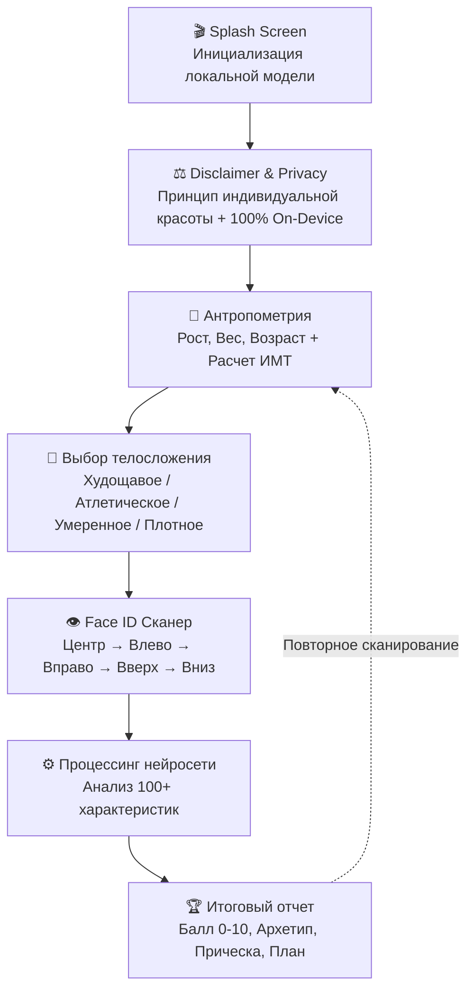

<div align="center">

# ⚡ MogChecker

**AI-Powered Facial Proportions, Haircut Rating & Aesthetic Symmetry Analyzer**

[](https://github.com/kohimmz/MogChecker/releases)
[](LICENSE)
[](https://github.com/kohimmz/MogChecker)
[](https://github.com/kohimmz/MogChecker)

[📥 Скачать готовый APK (v1.0)](https://github.com/kohimmz/MogChecker/releases) • [📱 Скриншоты и Архитектура](#-архитектура-экранов) • [🚀 Сборка проекта](#-сборка-и-запуск) • [🔒 Конфиденциальность](#-политика-конфиденциальности)

</div>

---

## 📖 О проекте

**MogChecker** — современное высокотехнологичное мобильное приложение в минималистичном черно-белом дизайне, созданное для детального анализа пропорций лица, оценки привлекательности прически и подбора персонального стиля на основе принципов золотого сечения.

Все биометрические вычисления и обработка видеопотока с фронтальной камеры происходят **на 100% локально в оперативной памяти смартфона** без отправки изображений на внешние серверы.

---

## ✨ Ключевые возможности

- **Круговой Face ID сканер (Apple Style)**:
  - Интерактивный видоискатель с радиальными засечками (48 сегментов) по эталону Face ID.
  - Пошаговое отслеживание положения головы во всех ракурсах: **Центр**, **Влево**, **Вправо**, **Вверх**, **Вниз**.
  - Динамическая 3D-сетка ключевых точек лица (челюсть, глаза, скулы, нос, губы, контур волос).
- **Оценка 100+ анатомических характеристик**:
  - Индекс золотого сечения Фи ($\Phi = 1.618$) и соотношение ширины к высоте лица (fWHR).
  - Кантал-тилт (угол наклона глазной щели: положительный, нейтральный, отрицательный).
  - Гониальный угол нижней челюсти (115°–125°) и проекция подбородка.
  - Ширина скуловых дуг (Bizygomatic width) и выраженность скул.
  - Баланс третей лица (Trichion — Glabella — Subnasale — Gnathion).
- **Оценка и разбор привлекательности прически**:
  - Рейтинг прически от **0.0 до 10.0**.
  - Определение формы лица (Овал, Квадрат, Ромб, Круг, Прямоугольник).
  - Подбор топ-3 стрижек, идеально гармонизирующих черты черепа (Textured Quiff, Crop Fade, Curtains, Buzz Cut и др.).
  - Рекомендации барберов по стайлингу (солевой спрей, матовая глина, фейд).
- **Классификация по архетипам внешности**:
  - Сопоставление с эталонной иерархией типажей:
    - `Sub 3` (0.0 — 3.4) — начальный потенциал
    - `Sub 5` (3.5 — 4.9) — скрытый потенциал
    - `LTN` (5.0 — 5.8) — базовый типаж (Low Tier Normie)
    - `MTN` (5.9 — 6.8) — уверенная гармония (Mid Tier Normie)
    - `HTN` (6.9 — 7.9) — высокая эстетика (High Tier Normie)
    - `Chad` (8.0 — 9.1) — выдающийся архетип
    - `True Adam` (9.2 — 10.0) — вершина эстетики
- **Персональный научно обоснованный план луксмаксинга**:
  - Техники осанки и положения языка (Mewing).
  - Коррекция процента подкожного жира под выбранный тип телосложения.
  - Лимфодренаж и мужской уход за кожей.

---

## 📱 Архитектура экранов



1. **Splash Screen**: Минималистичный логотип и анимированная шкала прогресса.
2. **Дисклеймер**:
   - «Не все люди идеальны — каждый человек по-своему красив»: акцент на то, что алгоритм измеряет лишь математические пропорции.
   - Психологический контекст и отказ от ответственности.
   - Гарантия конфиденциальности локальной памяти смартфона.
3. **Меню параметров тела**: Интерактивные слайдеры роста (140–220 см), веса (40–150 кг), возраста (14–75 лет) и мгновенный расчет ИМТ (BMI).
4. **4 Карточки телосложения**: Минималистичные векторные силуэты (Эктоморф, Мезоморф, Нормостеник, Эндоморф).
5. **Face ID круговой сканер**: 48 радиальных засечек со светящимся заполнением при повороте головы.
6. **Экран анализа**: Высокотехнологичная анимация синтеза 100+ параметров.
7. **Результаты**:
   - Карточка общего рейтинга от 0.0 до 10.0.
   - Бейдж и карточка архетипа.
   - Разбор прически и рекомендации лучших мужских стрижек.
   - Подробный аккордеон 100+ геометрических признаков.
   - Персональный пошаговый план улучшений.

---

## 📥 Установка APK на Android

1. Перейдите в раздел [Releases](https://github.com/kohimmz/MogChecker/releases) и скачайте актуальный файл `MogChecker-v1.0.apk`.
2. Откройте скачанный `.apk` файл на вашем телефоне.
3. При запросе разрешите установку приложений из внешних источников для вашего браузера или файлового менеджера.
4. Нажмите **Установить** и запустите приложение.

---

## 🛠️ Стек технологий

- **Фреймворк UI**: React 18, TypeScript, Vite
- **Стилизация**: Tailwind CSS (Dark Luxury Monochrome palette), Lucide Icons
- **Мобильный мост**: Capacitor 6 (`@capacitor/core`, `@capacitor/android`, `@capacitor/camera`)
- **Компьютерное зрение**: On-device Canvas 3D Landmark Mesh & Head-Pose Estimator
- **Сборка Android**: Android SDK 34, OpenJDK 17, Gradle 8.2.1

---

## 🚀 Сборка и запуск из исходного кода

### 1. Клонирование репозитория
```bash
git clone https://github.com/kohimmz/MogChecker.git
cd MogChecker
```

### 2. Установка зависимостей
```bash
pnpm install
```

### 3. Локальный запуск в режиме разработки
```bash
pnpm run dev
```
Приложение откроется по адресу `http://localhost:5173`.

### 4. Сборка веб-дистрибутива и синхронизация с Android
```bash
pnpm run build
npx cap sync android
```

### 5. Сборка APK через Gradle
```bash
cd android
./gradlew assembleDebug
```
Собранный файл появится по пути:
`android/app/build/outputs/apk/debug/app-debug.apk`

---

## 📦 Публикация в Google Play Store

Проект полностью настроен для Google Play Store с поддержкой целевого SDK Android 34:

1. **Создание релизного бандла (AAB)**:
   ```bash
   cd android
   ./gradlew bundleRelease
   ```
   Итоговый файл будет сгенерирован в:
   `android/app/build/outputs/bundle/release/app-release.aab`

2. **Подписание ключом разработчика**:
   ```bash
   jarsigner -verbose -sigalg SHA256withRSA -digestalg SHA-256 \
     -keystore my-release-key.jks \
     android/app/build/outputs/bundle/release/app-release.aab alias_name
   ```

3. **Загрузка в Google Play Console**:
   - Перейдите в [Google Play Console](https://play.google.com/console).
   - Создайте новое приложение **MogChecker**.
   - В разделе **Рабочая версия (Production)** загрузите файл `app-release.aab`.

---

## 🔒 Политика конфиденциальности (100% On-Device)

Приложение **MogChecker** создано с максимальным уважением к приватности пользователя:
- Никакие изображения, видеопоток камеры или биометрические дескрипторы не отправляются на удаленные серверы.
- Все расчеты производятся в локальной оперативной памяти устройства.
- Данные очищаются при перезапуске приложения.

---

## 📄 Лицензия

Проект распространяется под открытой разрешающей лицензией [MIT](LICENSE). Разрешено использование, модификация и публикация в магазинах приложений.